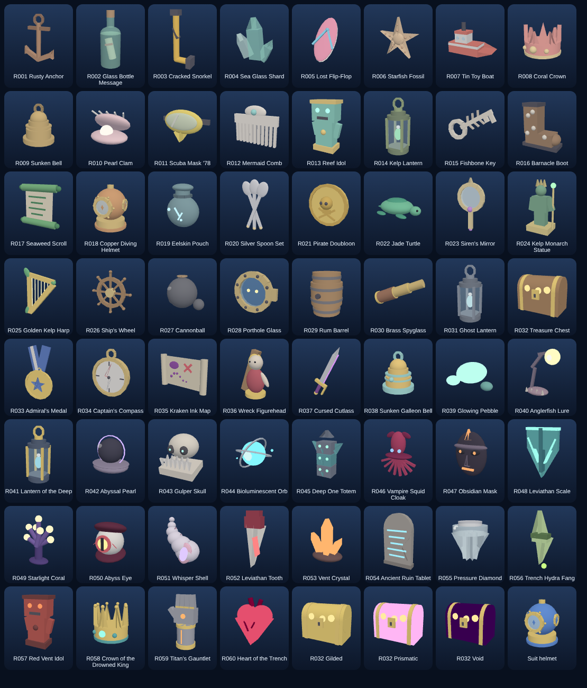

# Abyss Salvage

A co-op deep-sea salvage game for Roblox: dive through five depth zones, salvage relics with rarities and mutations, display them on your dock for idle Coins, raid other docks, escape the Leviathan, and Resurface for permanent multipliers.

- Design: [`ABYSS_SALVAGE_MASTER_PLAN.md`](ABYSS_SALVAGE_MASTER_PLAN.md)
- What's built vs. what's left: [`docs/IMPLEMENTATION_STATUS.md`](docs/IMPLEMENTATION_STATUS.md)
- UI & visual overhaul: [`docs/UI_OVERHAUL_PLAN.md`](docs/UI_OVERHAUL_PLAN.md)



The game runs from this repo alone. The graybox world (ocean, zones, plaza, 16 docks) is generated at runtime, so you don't need a place file.

## Setup

1. Install [Aftman](https://github.com/LPGhatguy/aftman), then run `aftman install`. This installs Rojo, Selene, StyLua and Lune at the versions pinned in `aftman.toml`.
2. Run `rojo serve` and click **Connect** in the Rojo Studio plugin.
3. In Studio:
   - **Game Settings → Avatar:** set the avatar type to **R15**. This is required for the 18+ DevEx boost (§2.4).
   - **Game Settings → Security:** turn on **Enable Studio Access to API Services** so profiles save. Without it, profiles stay in memory only, which is fine for playtesting.
4. Press **Play**.

### Testing paid items in Studio

Every pass and product in `src/shared/Config/Passes.luau` and `Products.luau` still has `id = 0`. When you "buy" one of these in Studio, it is granted instantly, so you can test every handler. On a live server they are refused until you add the real IDs.

Admin chat commands (the place owner is always an admin):

```
/as coins 100000      /as pearls 500       /as level 15        /as suit 4
/as relic Mythic      /as pass VIP         /as product Revive  /as event BloodTide 5
/as luck 2 15         /as raids off        /as live reload     /as ban <userId> <hours>
```

## Project structure

| Folder | Maps to | Contents |
|---|---|---|
| `src/server/` | ServerScriptService | `init.server.luau` boot script and 24 `Services/` |
| `src/client/` | StarterPlayerScripts | `init.client.luau` boot script, `Controllers/`, `UI/` (`Kit`, `Icons`, `RelicView`, `RelicCard`) |
| `src/shared/` | ReplicatedStorage.Shared | `Config/` (all tuning), `Net`, `LootRoll`, `Formulas`, `RelicArt` (procedural relic models), utilities |
| `tests/` | — | Lune unit tests (`lune run tests/run`) |
| `tools/` | — | Economy simulator (`lune run tools/economy_sim`) |

All tuning numbers are in `src/shared/Config/`. Values marked `[live]` in `Economy.luau` can be overridden without publishing: write a table to the `LiveConfig` key of the `AbyssSalvage_Live` DataStore, then run `/as live reload`.

## Checks

```bash
selene src
lune run tests/run
lune run tools/relic_art_check
lune run tools/economy_sim
rojo build -o AbyssSalvage.rbxl
```

CI (`.github/workflows/ci.yml`) runs the lint, the tests and a Rojo build on every push.
